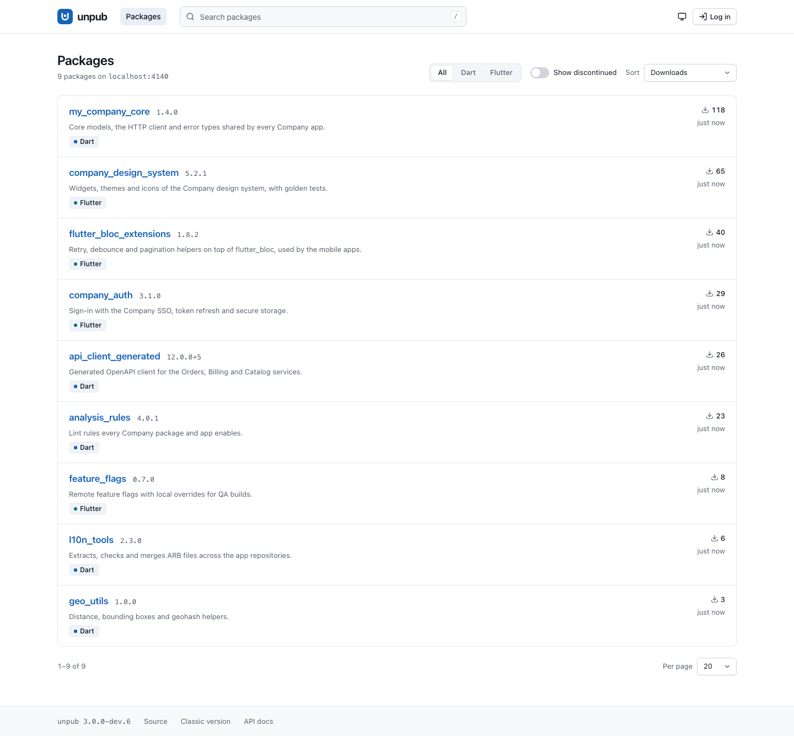

# Unpub

Unpub is a self-hosted private Dart Pub server for teams, with a simple web interface to search and view package information. It is a single binary that stores metadata in MongoDB and package archives on disk or in S3.

> **This is a modernization in progress.** User accounts, roles and personal API tokens are in place. The plan for policies, the new web UI and administration is in [docs/ROADMAP.md](docs/ROADMAP.md).



## Quick start with Docker

```sh
cat > .env <<EOT
UNPUB_AUTH_ADMIN_EMAIL=you@example.com
UNPUB_AUTH_ADMIN_PASSWORD=$(openssl rand -hex 16)
UNPUB_SERVER_PUBLIC_URL=http://localhost:4000
EOT

docker compose up -d --build
curl http://localhost:4000/readyz
docker compose exec unpub /app/unpub admin create-token --email you@example.com --name laptop
```

The first start creates the administrator. The last command prints an API token, once.

## Publishing and consuming packages

Give the Dart client a personal token and set the server in the package's `pubspec.yaml`:

```sh
dart pub token add http://localhost:4000 # paste the token secret
```

```yaml
publish_to: http://localhost:4000
```

Then run `dart pub publish`. To depend on a package:

```yaml
dependencies:
  my_package:
    hosted: http://localhost:4000
    version: ^1.0.0
```

Packages not found locally redirect to the upstream, pub.dev by default, so setting `PUB_HOSTED_URL` to this server also works for mixed dependency trees.

Reading is public by default, and only publishing and uploader management need a token. To make the registry private, set `auth.readAccess: authenticated`. Every route except `/healthz`, `/readyz` and the login endpoint then needs a token or session, which `dart pub get` provides once the token is added with `dart pub token add`. The embedded web UI cannot send tokens, so it does not work in that mode until the new UI arrives. Badges under `/badge/...` and every other anonymous GET answer 401 as well, so shields.io and similar scrapers cannot fetch them from a private registry.

Dart clients only send tokens over HTTPS, except to localhost, so deploy behind TLS.

## Authentication

### Roles

| Role | May |
| --- | --- |
| `admin` | Everything: manage users, publish to any package, manage the uploaders of any package. |
| `publisher` | Publish new packages, publish to packages where their email is in `uploaders`, and manage the uploaders of those packages. |
| `reader` | Read only, and look after their own account: log out, change their password, manage their own `read` tokens. This matters when `auth.readAccess` is `authenticated`. |

Package `uploaders` remain a list of email addresses, matched against the authenticated user ignoring case. A package without an `uploaders` list can only be changed by an administrator.

### Tokens and sessions

A request is authenticated by the first of these that matches. Anything else is anonymous.

1. `Authorization: Bearer <secret>` with a personal token that is neither revoked nor expired.
2. The `unpub_session` cookie from `POST /webapi/login`. Requests other than GET, HEAD and OPTIONS must also send its CSRF token, in the `X-CSRF-Token` header or the `csrf_token` form field.
3. The deprecated static tokens: `auth.bootstrapToken` acts as an administrator with the email `auth.bootstrapEmail`, and each entry of `auth.readTokens` acts as a reader. The server logs a warning when they are set. Move to personal tokens.

Personal tokens have the scopes `read` and `publish`. A scope narrows what the role allows and never widens it, so a `read` token cannot change anything even for an administrator. A session holds the scopes its role allows. Only the hash of a secret is stored. It is shown once, when created.

Credentials and roles can only be changed with a password login or `unpub admin`. Every kind of token, including `auth.bootstrapToken`, gets 403 with the code `session_required` when it tries to create a user, set a password or change a user. A token can still create tokens for its own user, within its own scopes and expiry, and revoke tokens of its own user.

```sh
unpub admin create-token --email you@example.com --name laptop --scopes read,publish --expires-in 90d
dart pub token add https://pub.example.com
```

### Administrators

Set `auth.admin.email` and `auth.admin.password` (or `UNPUB_AUTH_ADMIN_EMAIL` and `UNPUB_AUTH_ADMIN_PASSWORD`) to create the first administrator when the server starts with no users. Once any user exists, including the placeholders made by `unpub migrate`, these values are ignored and the server logs that. Use `unpub admin` from then on.

| Command | Description |
| --- | --- |
| `unpub admin create-user --email <address> --role <role> [--display-name <name>] [--password <secret> \| --password-stdin]` | Create a user. Without a password it is a placeholder that cannot log in. `--password` is visible in the process list. |
| `unpub admin set-password --email <address> [--password-stdin]` | Set a password, prompting on a terminal. Ends the sessions of the user. |
| `unpub admin set-role --email <address> --role <role>` | Change a role. |
| `unpub admin disable --email <address>`, `unpub admin enable --email <address>` | Disable or re-enable a user. A disabled user's tokens and sessions stop working. |
| `unpub admin list-users` | List users. |
| `unpub admin create-token --email <address> --name <label> [--scopes read,publish] [--expires-in 30d]` | Print a new token secret. Lifetimes use `s`, `m`, `h`, `d` or `w`. |

Each takes `--config <path>`. The last enabled administrator cannot be demoted or disabled. The ids of the enabled administrators are kept in one document, `enabled_admins` in the `admin_set` collection. Taking someone out of it is a single atomic update that refuses to empty it. The server and every `unpub admin` command except `list-users` rebuild this document from `users` when they start.

**Last admin protection.** The guard prevents the common mistakes, such as demoting or disabling the last administrator, or two administrators removing each other at the same moment. These answer 409 with the code `last_admin`, `admin_change_in_progress` or `conflict`. It is a safety net against mistakes, not a security boundary. MongoDB cannot change the `users` collection and the admin set in one transaction, so every change writes the set first and the user second, and writes the user only if its role and disabled state are still what the decision was based on. Under pathological concurrency a state with no enabled administrator is still theoretically reachable: a process stalled between its two writes for more than the 5 minute grace period of a removal, while a rebuild runs and the last other administrator is demoted. Direct writes to `users` outside unpub are also only repaired by the next rebuild. To recover, run `unpub admin set-role --email <address> --role admin` or `unpub admin create-user --email <address> --role admin` from the command line, neither of which needs an existing administrator.

### HTTP API

JSON endpoints under `/webapi`, for scripts and the upcoming web UI. Errors look like `{"error": {"code": "...", "message": "..."}}`, with status 400, 401, 403, 404, 409 or 429.

| Endpoint | Description |
| --- | --- |
| `POST /webapi/login` | `{email, password}`. Sets the session cookie and returns the user and `csrfToken`. |
| `POST /webapi/logout` | Ends the session. |
| `GET /webapi/me` | The current user and scopes, and `csrfToken` for a session. |
| `POST /webapi/me/password` | Session only: `{currentPassword, newPassword}`. Ends the other sessions of the user. |
| `GET`, `POST /webapi/tokens` | List or create your own tokens. Create takes `{name, scopes?, expiresIn?}` and returns the `secret` once. A token cannot create a token with more scopes or a later expiry than its own. |
| `DELETE /webapi/tokens/<id>` | Revoke your own token. An administrator logged in with a password can revoke any. A token or `auth.bootstrapToken` can only revoke tokens of its own user: revoking another user's token answers 403 `session_required` to an administrator's token and 404 to anyone else's. |
| `GET`, `POST /webapi/users` | Administrators: list users, or with a session create one from `{email, role, displayName?, password?}`. |
| `PATCH /webapi/users/<id>` | Administrators, session only: change `role`, `disabled` or `displayName`. Answers 503 if another change to an administrator stays in progress. |
| `POST /webapi/users/<id>/password` | Administrators, session only: `{password}`. |

After 10 failed attempts within 15 minutes, for one email or one client address, login answers 429 with `Retry-After`. The count is kept per process, so several instances each allow their own attempts. Each process tracks up to 50 000 addresses and emails. When that is full it forgets only expired counters and those below half the limit, and if that frees nothing it answers 429 to addresses and emails it does not know yet and logs a warning. Sessions last 24 hours.

Logins, token and user changes, publishes and uploader changes are recorded in the `audit` collection.

## Running from source

Requires the Dart SDK and MongoDB 3.6 or later. The server and `unpub admin` log the version they connect to and stop with a clear message on anything older.

```sh
docker compose -f docker-compose.dev.yml up -d mongo
cd unpub
dart pub get
dart run bin/unpub.dart serve --config ../unpub.example.yaml
```

To build a standalone binary, run `dart compile exe bin/unpub.dart -o unpub`.

## Command line

| Command | Description |
| --- | --- |
| `unpub serve [--config path] [--host address] [--port number]` | Start the server. |
| `unpub version` | Print the version. |
| `unpub --help` | Print usage. |
| `unpub migrate [--dry-run] [--config path]` | Apply pending data migrations, or list what would change. |
| `unpub admin ...` | Manage users and tokens. See [Administrators](#administrators). |

## Configuration

Settings are resolved in this order, with later ones winning: built-in defaults, the YAML file, environment variables, then the `--host` and `--port` flags. Startup fails with a list of every problem if the configuration is invalid.

The file is `unpub.yaml` in the working directory, or the path given with `--config`. See [unpub.example.yaml](unpub.example.yaml) for a commented example.

Any key can be set through a variable named `UNPUB_<SECTION>_<KEY>`. CamelCase keys take underscores, so `server.publicUrl` is `UNPUB_SERVER_PUBLIC_URL`.

| Key | Environment variable | Default | Description |
| --- | --- | --- | --- |
| `server.host` | `UNPUB_SERVER_HOST` | `0.0.0.0` | Listen address. |
| `server.port` | `UNPUB_SERVER_PORT` | `4000` | Listen port. |
| `server.publicUrl` | `UNPUB_SERVER_PUBLIC_URL` | derived from the request | External origin, used in archive and upload URLs. Set it behind a reverse proxy. `https` also marks the session cookie `Secure`. |
| `server.trustForwardedFor` | `UNPUB_SERVER_TRUST_FORWARDED_FOR` | `false` | Take the client address for the login limit and the audit log from the last entry of `X-Forwarded-For`. Only enable behind a proxy that sets it. |
| `mongo.uri` | `UNPUB_MONGO_URI` | `mongodb://localhost:27017/dart_pub` | MongoDB URI, including the database name. |
| `storage.type` | `UNPUB_STORAGE_TYPE` | `file` | `file` or `s3`. |
| `storage.file.path` | `UNPUB_STORAGE_FILE_PATH` | `unpub-packages` | Directory for archives. |
| `storage.s3.bucket` | `UNPUB_STORAGE_S3_BUCKET` | | Bucket name. Required for `s3`. |
| `storage.s3.region` | `UNPUB_STORAGE_S3_REGION` | `AWS_DEFAULT_REGION` | Region. Required for `s3`. |
| `storage.s3.endpoint` | `UNPUB_STORAGE_S3_ENDPOINT` | `AWS_S3_ENDPOINT` or `s3.amazonaws.com` | Host name of the S3 service. |
| `storage.s3.port` | `UNPUB_STORAGE_S3_PORT` | | Port of the S3 service. |
| `storage.s3.useSSL` | `UNPUB_STORAGE_S3_USE_SSL` | `true` | Use HTTPS. |
| `storage.s3.pathStyle` | `UNPUB_STORAGE_S3_PATH_STYLE` | automatic | Force path-style bucket addressing. |
| `storage.s3.accessKey` | `UNPUB_STORAGE_S3_ACCESS_KEY` | `AWS_ACCESS_KEY_ID` | Access key. |
| `storage.s3.secretKey` | `UNPUB_STORAGE_S3_SECRET_KEY` | `AWS_SECRET_ACCESS_KEY` | Secret key. |
| `storage.s3.sessionToken` | `UNPUB_STORAGE_S3_SESSION_TOKEN` | | Session token for `storage.s3.accessKey`. Keys from the environment use `AWS_SESSION_TOKEN` instead. |
| `upstream.url` | `UNPUB_UPSTREAM_URL` | `https://pub.dev` | Where unknown packages redirect. |
| `auth.admin.email` | `UNPUB_AUTH_ADMIN_EMAIL` | | First administrator, created when there are no users. Set together with the password. |
| `auth.admin.password` | `UNPUB_AUTH_ADMIN_PASSWORD` | | Password of that administrator, at least 8 characters. Prefer the environment. |
| `auth.readAccess` | `UNPUB_AUTH_READ_ACCESS` | `public` | `public`, or `authenticated` to require a token or session on every route except `/healthz`, `/readyz` and login. |
| `auth.bootstrapToken` | `UNPUB_AUTH_BOOTSTRAP_TOKEN` | | Deprecated. Static Bearer token that acts as an administrator. |
| `auth.bootstrapEmail` | `UNPUB_AUTH_BOOTSTRAP_EMAIL` | `admin@localhost` | Email of the `auth.bootstrapToken` identity, and the uploader recorded for its publishes. |
| `auth.readTokens` | `UNPUB_AUTH_READ_TOKENS` | | Deprecated. Static Bearer tokens that act as readers. A YAML list, or comma separated in the environment. |
| `logging.level` | `UNPUB_LOGGING_LEVEL` | `info` | `fine`, `info`, `warning`, `severe` and other `package:logging` levels, or `off`. |
| `logging.format` | `UNPUB_LOGGING_FORMAT` | `text` | `text` or `json`. |

Without `storage.s3.accessKey`, S3 credentials come from the standard AWS variables or the ECS task role. Credentials are never combined across these sources.

### Upgrading from 2.x

- The `--database` and `--proxy-origin` flags and the `proxy-origin` header are replaced by `mongo.uri` and `server.publicUrl`.
- Google sign-in is gone. The environment variables map as follows:

  | 2.x | 3.x |
  | --- | --- |
  | `UPLOAD_TOKEN` | `auth.bootstrapToken` |
  | `UPLOAD_EMAIL` | `auth.bootstrapEmail` |
  | `ALLOWED_TOKENS` | `auth.readAccess: authenticated` and `auth.readTokens` |

- A registry that set `ALLOWED_TOKENS` was private. It becomes world-readable unless you set `auth.readAccess: authenticated`, which is not the default.
- The embedded web UI cannot send tokens, so it is unusable in `authenticated` mode, as it was with `ALLOWED_TOKENS`, until the new UI replaces it. Badges under `/badge/...` need a token in that mode too, so public badge images stop working.
- A package without an `uploaders` list can now only be changed by an administrator.
- Accounts: run `unpub migrate` once. It creates a placeholder `publisher` for every email in existing `uploaders`, and an `admin` for `auth.bootstrapEmail` if it appears there. Check first with `unpub migrate --dry-run`. Placeholders cannot log in, so give them a password with `unpub admin set-password` or a token with `unpub admin create-token`.
- Run `unpub migrate` after creating your first administrator, or use `unpub admin create-user` afterwards: `auth.admin.*` is ignored once any user exists.
- `auth.bootstrapToken` and `auth.readTokens` keep working but are deprecated. Replace them with personal tokens. Neither these nor personal tokens can manage users over HTTP, so use `unpub admin` or log in.
- Package names must now match `[a-z_][a-z0-9_]*` and be at most 64 characters long. A stored package with any other name is no longer reachable.
- MongoDB documents and the archive layout are unchanged. Archives stay in `unpub-packages` by default. Accounts live in the new collections `users`, `tokens`, `sessions`, `audit`, `admin_set` and `migrations`.

### Behind a reverse proxy

Set `server.publicUrl` to the external origin, and use HTTP/1.1 towards unpub:

```nginx
proxy_http_version 1.1;
proxy_set_header Host $host;
proxy_set_header X-Forwarded-For $proxy_add_x_forwarded_for;
client_max_body_size 100m;
```

Also set `server.trustForwardedFor: true`, or the login limit and the audit log see only the address of the proxy, and one user's failures would lock out everyone.

## Operations

| Endpoint | Description |
| --- | --- |
| `GET /healthz` | Returns 200 while the process is up. |
| `GET /readyz` | Checks MongoDB and that storage accepts writes, by writing and deleting a probe (on S3, under `.unpub/`). Returns 200, or 503 with JSON details. |

The server logs one line per request to stdout, in text or JSON. On SIGINT or SIGTERM it stops accepting connections, drains requests for up to 30 seconds and closes MongoDB. A second signal exits immediately.

The server does not reconnect after losing its MongoDB connection. `/readyz` then keeps returning 503 until the process is restarted, so restart it when that happens.

## Using unpub as a library

The `App` class can be embedded for custom stores or upload rules.

```dart
import 'package:mongo_dart/mongo_dart.dart';
import 'package:unpub/unpub.dart' as unpub;

Future<void> main() async {
  final db = Db('mongodb://localhost:27017/dart_pub');
  await db.open();

  final app = unpub.App(
    metaStore: unpub.MongoStore(db),
    packageStore: unpub.FileStore('./unpub-packages'),
    authenticator: const unpub.StaticTokenAuthenticator(
      bootstrapToken: 'a-long-random-token',
    ),
    uploadValidator: (pubspec, uploaderEmail) async {
      // Throw to reject the upload.
      final name = pubspec['name'] as String;
      if (!name.startsWith('my_company_')) {
        throw 'Package name should start with my_company_';
      }
    },
  );

  await app.serve('0.0.0.0', 4000);
}
```

`MetaStore`, `PackageStore`, `Authenticator` and `AuditStore` can each be replaced by your own implementation. The account endpoints are added by passing an `AccountApi`. `S3Store` and `FileStore` are included.

## Badges

| URL | Badge |
| --- | --- |
| `/badge/v/{package_name}` |  |
| `/badge/d/{package_name}` |  |

## Development

```sh
docker compose -f docker-compose.dev.yml up -d mongo
cd unpub
dart test
```

Set `UNPUB_TEST_MONGO_URI` to use another database. The S3 tests run when `UNPUB_TEST_S3_ENDPOINT` points to an S3 compatible service. Run `make generate` after changing routes or models. Commits follow [Conventional Commits](https://www.conventionalcommits.org).

## Credits

- [pub-dev](https://github.com/dart-lang/pub-dev): web page styles are mostly taken from https://pub.dev.
- [shields](https://shields.io): badge generation.
- [bytedance/unpub](https://github.com/bytedance/unpub): the project this is forked from.

## License

MIT
